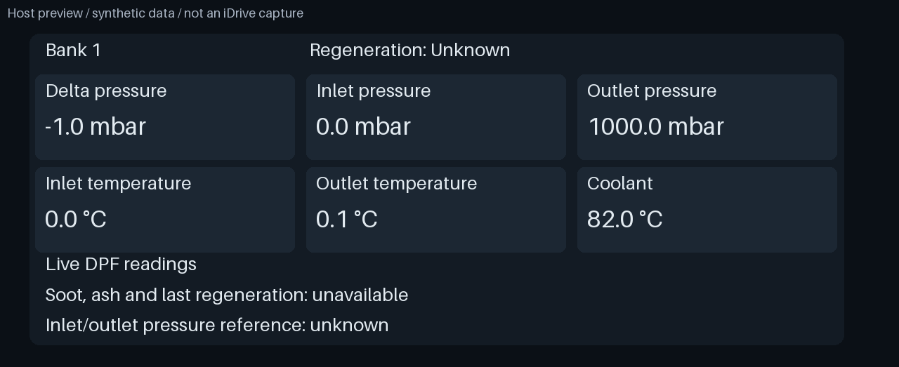

# DPFDeck

DPFDeck is an experimental native monitoring app for vehicles advertising
standard DPF pressure and temperature PIDs. Source includes the worker,
six-tile dashboard, native OPTIONS menu, resource generator and optional
installer integration. Host and simulated transport checks pass. No QNX build,
installation, firmware approval or physical vehicle support is claimed,
including for the owner's N57 X5.



The preview uses production XML, original background artwork and model updates
captured from real plugin callbacks with synthetic data and host fonts. It is
not an iDrive capture or evidence of on-car rendering.

## Dashboard

The six tiles show delta, inlet and outlet pressure, inlet and outlet temperature
for the selected bank, plus coolant. **OPTIONS → DPFDeck settings** selects
bank 1/2 and metric (mbar/C) or imperial (psi/F) units. Each tile independently
shows Unknown, Unsupported, Unavailable, Stale or a valid measurement. Valid
zero and negative delta pressure remain measurements.

Regeneration stays **Unknown**. Soot, ash and last-regeneration values stay
**unavailable**; inlet/outlet pressure reference stays **unknown**. Pressure and
temperature never supply inferred regeneration states, completion estimates or
universal soot/ash thresholds. There are no vehicle controls.

Bank and units use a separate four-byte D1 record at
`/var/opt/hmi/data/ID5/DPFDeck.prefs`. Invalid records default to bank 1/metric.
Saves use the existing atomic persistence helper; failure keeps the previous
choice and shows an error. Other app preferences are untouched.

## Diagnostic evidence and scope

Work follows the B47/N57 discussion in
[#196](https://github.com/inotbarnacle/iDriveDeck/issues/196); there was no
contributor implementation branch at the checked revision. The separate
[#201 discovery profile](https://github.com/voioo/iDriveDeck/blob/15857d6f084dacb2e4cc21626e06048f7116ea62/source/docs/DIESEL-VALIDATION.md#optional-standard-dpf-pressure-and-temperature-evidence-profile)
can collect standard DPF evidence after review and explicit owner approval.

The worker uses only these Mode 01 reads, addressed to DME/DDE 12:

- Supported-PID bitmaps 00, 20, 40 and 60, following continuation bits.
- Advertised coolant PID 05.
- Advertised PID 7A/7B bank 1/2 delta, inlet and outlet pressure.
- Advertised PID 7C bank 1/2 inlet/outlet temperatures.

It does not infer an engine family. Exact support, bank identity, pressure
reference and calibration on N57/B47/B57 remain unverified.
[DashLogic's PID reference](https://www.dashlogic.com/docs/technical/obdii_pids)
corroborates the layouts and signed delta pressure in the
[pinned OBDb reference](https://github.com/OBDb/SAEJ1979/blob/1abdef6ae0c1b9134c8f2a10911a9daa1354649d/signalsets/v3/default.json).
No vendor database, descriptions or captures are copied into this branch.

Six pressure fields use kPa internally: delta is signed big-endian / 100;
inlet/outlet are unsigned / 100, with no assumed absolute/atmospheric reference.
Four temperatures use unsigned / 10 - 40 C; coolant is unsigned minus 40 C.
Pressure support bits 0/1/2 and temperature bits 0/1/2/3 are independent, with
exact lengths and reserved-bit rejection. No delta is derived from inlet/outlet
and no generic EGT substitutes for a DPF position.

Temperature above 1800 C stays supported but unavailable in this app. This is
an application plausibility envelope, not a BMW limit or regeneration threshold.
The discovery report retains the full protocol temperature domain for review.
FFFF delta is -0.01 kPa and valid; no universal FFFF sentinel is invented.

Regeneration active/requested/inhibited, soot/ash mass, distance/time since last
regeneration and inhibition reasons remain unimplemented. There are no commands
for regeneration, reset, coding, emissions, actuators, fault clearing, diagnostic
session changes or dynamic DIDs.

## Polling, freshness and ownership

The capability helper is identical to #202's shared implementation. Evidence
belongs to one DME/endpoint for the worker lifetime, across short diagnostic
leases. Unknown differs from unsupported; failed bitmaps back off five seconds.
A new bitmap consumes its tick before a measurement is sent.

At most one request is sent per 250-ms tick. Group reads are at least two seconds
apart from their actual start. Malformed/refused reads back off five seconds
and clear only that group's valid values. Current field flags are checked on
every reply. Samples expire independently after 4.5 seconds, including time
spent receiving, publishing and queuing a reply.

HSFZ and the existing DME MOST tunnel share the project's lease and shutdown
paths. Projection-hook installation disables this worker's MOST fallback. The
existing HSFZ-after-connect policy is preserved. Neither cable-free operation
nor CarPlay/HUD coexistence on the owner's firmware is established.

Loopback roles are data 42867, activity/source 42868 and MOST ownership 42869,
within #213's excluded host receiver range. The HUD checks the new marker; the
tunnel retains it through teardown. Existing markers prevent another client;
activity socket ownership prevents duplicate DPF workers. OS process exit
releases sockets. A project lease cannot exclude an external diagnostic device.

DPF1 is a separate locale-independent ASCII protocol with eleven fields, strict
masks/numbers, final newline and a 512-byte buffer bound. It includes sequence,
worker PID, launch token, monotonic send time and per-field ages. Invalid fields
have zero placeholders with validity clear; availability never follows numeric
zero. New fields require a new wire version. BoostDeck channels, packets, saved
settings and existing layouts are unchanged.

The HMI accepts only its owned live worker PID/token at 127.0.0.1:42868 with a
fresh timestamp. It rejects wrong framing, replayed sequences, regressing time,
oversized packets and earlier launches. Each poll drains at most eight packets.

The worker runs while the dashboard or OPTIONS state is visible. OPTIONS
transitions retain the worker and frame. Closing requests termination once and
retains ownership until reaped or confirmed absent, following Andreas Boehm's
[#143 lifecycle work](https://github.com/inotbarnacle/iDriveDeck/pull/143).
ECHILD alone does not prove exit. Busy receivers and failed launches retry no
faster than every two seconds. Finalization closes the receiver and invalidates
queued callbacks. The worker also exits when its parent disappears.

Connector 123 and DPF1 are independent of BoostDeck identifiers. Combining this
branch with [#211](https://github.com/inotbarnacle/iDriveDeck/pull/211) requires
reconciling its new MOST ownership name map and coordination ports; its PowerDeck
connector 121 does not establish DPFDeck coexistence or ECU compatibility.

## Build and optional installer payload

Generate resources with Python and Pillow:

```sh
python3 source/tools/make_dpfdeck.py
```

Native compilation requires licensed QNX SDP 6.5 and authorized private framework
link inputs. The legitimate acquisition process is documented in
[#208](https://github.com/inotbarnacle/iDriveDeck/pull/208). An SDK 8 evaluation
does not itself provide legacy SDK entitlement. Prepare those inputs before
running `source/native/build.sh`. This contribution downloads no SDK and
includes no generated native binaries or BMW libraries.

Package an actual native build explicitly:

```sh
python3 source/tools/package_dpfdeck.py \
  --qnx-out /private/qnx-build/out \
  --out /private/packages/dpfdeck.zip
```

The packager checks ELF32 little-endian ARM headers/load segments, app identity,
resources and checksums. That does not establish QNX ABI, loader or vehicle
compatibility. Output creation is exclusive. The ZIP contains five app files,
a sanitized build record and checksums.

To offer DPFDeck in a locally built installer, place the reviewed archive at
`packages/dpfdeck.zip` and use the existing
[staging process](../tools/desktop-installer/README.md). Without it, staging
removes old DPF payload and the installer disables installation. DPFDeck is an
explicit unchecked choice; legacy defaults stay unchanged. Removal remains
available without the payload. This contribution includes no DPF archive.

Only 1280×480, 1440×540 and 1920×720 wide layout geometries are supplied. The
installer rejects DPFDeck on compact/unknown panels before a transaction. Layout
checks do not approve firmware; no installer firmware profile is added.

## Parked validation and rollback

Physical installation, temporary SSH, experimental collectors and restarts each
require explicit owner authorization. ENET availability alone is not permission.
Before an authorized trial:

1. Collect exact DDE/EGS identifiers, advertised PIDs, framework hashes and active
   display resolution using the reviewed, bounded discovery procedure. Compare
   intended signals against independent diagnostic evidence.
2. Run the installer compatibility check without installing. Review exact
   framework/loader evidence, storage and connector conflicts. Keep the vehicle
   parked with suitable battery support and test one app at a time.
3. Preserve any previous `Plugins/DPFDeck` outside `Plugins`. Separately save
   `DPFDeck.prefs`, or record its absence. Record the installer backup path and
   modified files. Select DPFDeck explicitly and keep other required managed
   menus selected, since installation replaces the managed menu selection.
4. Verify uploaded bytes/permissions before an authorized restart. Check units,
   bank persistence, unavailable/stale values, OPTIONS transitions, exit/worker
   cleanup and coexistence. Check factory menus, CarPlay, navigation, audio,
   Bluetooth, camera and parking displays.
5. After parked stability, test standalone operation with ENET, laptop and
   external OBD adapters disconnected. Record results; host tests do not prove it.

To remove the app, select only DPFDeck in Uninstall and record the backup path.
Preferences are preserved. To restore a prior version, move its complete backup
back to `Plugins/DPFDeck`, with no duplicate or connector conflict, and restore
the separately saved preference record (or its original absence). Restart only
with authorization and repeat factory-function checks. Unexpected warnings,
freezes or factory regressions require stopping and restoring the prior state.
Host transaction tests cover failure/rollback; physical restoration is untested.

## Host checks

```sh
make -C source/native test-dpf
make -C source/native test
python3 source/tools/test_dpf_resources.py
```

The full suite runs ten native programs and 96 Python cases. Tests use loopback
HSFZ and fake DSI/MOST, with #213's private receiver allocator. They cover full
16-bit decoder domains, flags, units, framing, negative/truncated replies,
backoff/rate bounds, reconnects, duplicate ownership and MOST teardown.
Production HMI callback tests cover sender ownership, replay, sequence wrap,
independent tile states, bounded drains, preferences/save failures, OPTIONS,
finalization and child cleanup. A Linux guardian terminates the actual worker's
parent and verifies worker exit and socket release.

Two handoff cases run the actual DPF and Boost workers against one synthetic
gateway. They check progress while overlapping, serialized in-flight requests,
activity/lease release and continued Boost reads after normal or abnormal DPF
exit. These observations do not establish physical coexistence or exclude an
external diagnostic tester.

Seven resource/package cases cover deterministic generation, layout bounds,
ARM/resource rejection and optional staging. The Go suite includes selection,
layout rejection before writes, connector conflicts, upload verification,
transaction rollback, update/removal and preference preservation. For host-only
installer tests without a QNX build:

```sh
python3 source/tools/test_dpf_resources.py --stage-installer-fixture
cd source/tools/desktop-installer
go test -count=1 ./...
```

The explicit fixture contains synthetic ELF-shaped data, not QNX programs. A
marker disables DPF installation and blocks release builds until real inputs
stage successfully. The marker precedes the first synthetic payload file and
survives interrupted staging. Never distribute or install it.

CI runs GCC/Clang, C++98 syntax, core/plugin ASan/UBSan and static analysis. A
temporary German locale checks ASCII packets under a comma decimal locale,
without changing the system locale. All results remain host/simulation evidence.

Remaining evidence includes exact ECU support, a licensed QNX build, firmware
ABI/loader review, actual rendering, parked lifecycle/factory checks and
standalone operation. Regeneration, soot/ash, time/distance and inhibition need
credible, appropriately licensed definitions plus exact-ECU validation.
