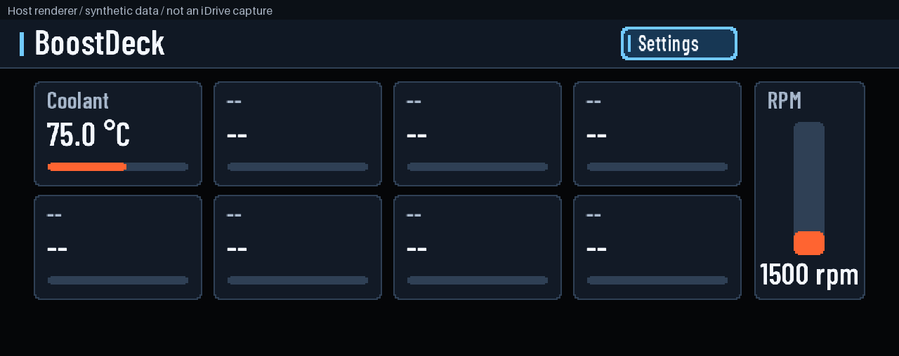
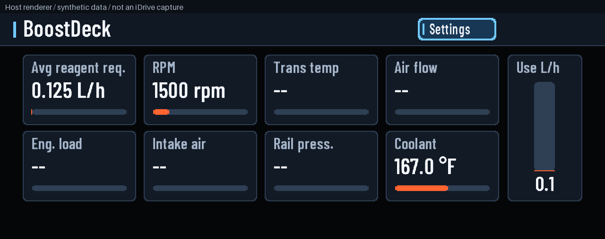

# Full-screen diesel telemetry

Full-screen BoostDeck now shares the standard app's public decoder, capability
cache and read-only worker implementation. The first 31 channel IDs retain their
meanings. Its picker also exposes the standard EGT, EGR, requested/actual pressure
and reagent fields, for 58 channels in total. The formats, sources and limits
are documented in [Signals](SIGNALS.md), [EGT](STANDARD-EGT.md),
[EGR](STANDARD-EGR.md), [pressure](STANDARD-PRESSURE.md) and
[reagent data](STANDARD-REAGENT.md). A menu choice does not establish ECU support.

Select **Settings → Engine profile → Diesel**. **Use detected diesel defaults**
fills slots from advertised standard capabilities and an existing transmission
temperature candidate only after a valid reply. Unknown support leaves a slot
empty. A supported channel can still return unavailable or stale data; it shows
`--`. Zero is retained when valid. RPM occupies the narrow tile when supported;
one supported EGT can enter defaults. Optional EGR, pressure pairs and reagent
fields remain manual choices and do not expand the default request pool.

Existing valid layouts stay in **Custom layout** until the owner selects
detected defaults. **Configure gauges** edits those saved choices, including
while detected defaults are active. Switching modes preserves them. An older
picker skipped identifiers containing digits, so selecting **Lambda target**
could save the **STFT bank 1** channel instead. The generator now checks all
names/actions against the channel catalogue. Stored IDs retain their original
meaning; an earlier unintended choice can be corrected by reselecting its name.

The shared worker checks supported-PID bitmaps before the standard reads covered
by the standard app's capability policy. In particular, unadvertised oil PID 5C
is not probed. MAP and derived boost remain unavailable at the standard MAP
limit of 255 kPa. This does not establish full-range diesel boost, a fixed BMW
oil DID, DPF mass/counters, SCR health or an N57 family. Full-screen WarmDeck now
shares the same oil capability gate; its temperature frame stays 48 bytes.

## Freshness and lifecycle

The worker sends from its bound activity socket. The Library checks the local
sender, packet size/type, opening time and future/older frame times. Detected
defaults additionally require the current worker PID and generation token,
consistent capability evidence and matching measurement time. Those fields and
the local port are not cryptographic authentication.

Values retain individual request ages. Display and alert checks use the same
cache, expire without needing another packet and reject samples from before the
page opened. Unit changes refresh cached measurements immediately. Profile,
active-layout and mode changes retire the current worker before replacement;
closed/retiring workers cannot supply the new page. The local diagnostic lease
does not exclude another physical OBD tester.

## Settings and rollback

Full-screen files keep their own namespace under `/var/opt/hmi/data/ID5/`:

| File | Record |
| --- | --- |
| `ID6LibraryLab.boost.prefs` | Existing G1/G2 color, units, style and alert choices. |
| `ID6LibraryLab.boost.signals` | Existing B1/B2 layouts and wider B3–B6 channel ranges. |
| `ID6LibraryLab.boost.signals.defaults` | D1 detected/custom mode. |

Loads do not rewrite files. B1/B2 IDs remain limited to the original 31 channels;
wider versions permit 39, 47, 55 or 58. Saving only old IDs keeps B2. If the
full-screen files are absent, the existing standard preference/layout import
remains available, without modifying its source. A valid imported layout stays
custom. The first layout save also preserves the current default mode, so a new
detected layout does not silently become custom after restart.

Physical files are replaced atomically, one file at a time. Saving mode and
layout is not a transaction; resolve a save warning and reselect before relying
on restart persistence. Failed saves retain the live choice and remain visible
on return to the dashboard. The emulator uses separate shared-memory files,
whose filesystem does not offer atomic rename. Its host bridge validates and
preserves G1/G2, B1–B6 and D1 records rather than assuming B2.

Back up the full matching bundle and all present settings, recording absent
paths, before any separately authorized installation. Rollback restores that
bundle and its backed-up settings; older full-screen builds cannot read the
newer channel ranges. Restore originally absent paths to that state as needed.

## Build and evidence

Build from the whole repository: full-screen source includes the shared public
standard implementation. The existing full-screen build script links capability
and default helpers explicitly. Host build-input checks record its compiler
arguments and link emitted Boost/Warm worker inputs with host fakes. Target-only
ARM flags and QNX PCM audio are omitted from that host link, while their presence
is checked in recorded target inputs. Recorder placeholders cannot run; separate
host fakes are linked but not executed. All outputs are private and removed after
the test. This is not a QNX build or a substitute for licensed
toolchain/framework inputs.

The surface protocol is **v4 (`ID6V`), 496 bytes**. It retains measured Warm/Shift
states and names the expanded Boost channels and empty slots. Versions 1–3 are
rejected. Rebuild the complete matching bundle from fresh output: Library,
workers, renderer, all app/optional companion plugins, layouts and emulator
components. This work builds on [ShiftDeck #203](https://github.com/inotbarnacle/iDriveDeck/pull/203)
and [WarmDeck #209](https://github.com/inotbarnacle/iDriveDeck/pull/209).

Host tests exercise production Library callbacks, private settings, local UDP,
the actual full-screen workers and C rasterizer. They cover legacy layouts,
mode persistence, 64-bit choices, PID/generation/source matching, stale/unknown/
zero values, units, save/read failures, all picker actions and five panel sizes.
Shared standard transport oracles also run against the full-screen worker
builds. The previews below render synthetic production updates on the host.
They do not establish QNX/ARM rendering or this X5's compatibility.
The captured gasoline state also produces identical pixels with the preceding
renderer (`b1221ad`) across five panels, both styles and all nine colors
(90 comparisons). The old picker provides a separate negative control for the
Lambda/STFT action mismatch.

The selectable diesel scale from #205 still needs its full-screen port; the
legacy rail gauge retains its existing display range here. EntryNav2 parity,
exact ECU support, licensed QNX/ABI checks, parked factory-function regression,
standalone operation and rollback validation remain open. No firmware profile,
native release binary or physical vehicle result is added by this change.
