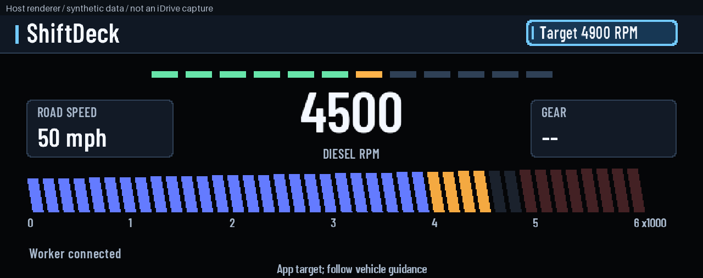

# ShiftDeck engine profiles

The existing shift-light presets and 8,000 RPM display are gasoline-oriented.
They are unsuitable as the only choices for a diesel dashboard. This change
adds a manually selected Diesel profile while preserving the existing Gasoline
profile and all 21 current presets (6000–8000 RPM in 100-RPM steps). The
existing Speed menu and its units remain available.

In the standard app, open **OPTIONS → Engine profile → Use diesel profile**, then **Configure diesel
target and display**. Set the advisory target in 100 RPM steps and choose a
0–4000, 0–5000 or 0–6000 RPM display. The target must be at least 1000 RPM and
below the selected display ceiling. Reducing that ceiling also reduces a target
that no longer fits, to 100 RPM below it; the current target is always shown.
Changing diesel settings while Gasoline is active leaves them inactive until
Diesel is selected. Selecting a gasoline preset explicitly restores Gasoline.
Each profile retains its own target; the speed-unit choice applies to both.

The initial diesel choices (4000 RPM target, 6000 RPM display) are configurable
app defaults, **not a verified N57 limit, BMW redline or operating instruction**.
They are not inferred from an ECU, model year or fuel type. The display scale is
an instrument setting, not an engine limiter. Choose the target for the exact
engine and conditions. The light is advisory and must not guide cold-engine
operation. No ECU request, limiter, gearbox command or vehicle setting changes.

Diesel scale artwork has no fixed redline band. The light and red presentation
depend on the chosen target. Its approach spans the last 1000 RPM below that
target; the existing Gasoline approach retains its 2000 RPM span. Numeric RPM,
sample freshness and speed decoding are unchanged. Missing, stale, future-dated
or hidden RPM data cannot activate the shift light. No interpolated value is
used to decide that the measured target was reached.

## Settings and rollback

Gasoline targets and speed units retain upstream's exact four-byte `G1` file at
`/var/opt/hmi/data/ID5/ShiftDeck.v2.prefs`. Diesel/profile choices use a separate
five-byte `S2` file, `ShiftDeck.diesel.prefs`. Diesel-only changes do not rewrite
the gasoline file. Explicit gasoline preset changes also select the Gasoline
profile; speed-unit changes affect the shared `G1` file only.

Loading does not rewrite either file. If the current gasoline file is absent or
invalid, the older `ShiftDeck.prefs` is read with upstream's five-preset conversion:
5800/6000/6250/6500/6700 become 6000/6000/6300/6500/6700 RPM. A legacy eight-byte
`S1` record can also provide the prior diesel choices when the new sidecar is
absent. Current gasoline choices take precedence over legacy gasoline fields,
and a valid new sidecar takes precedence over old profile fields. An unreadable
or malformed new sidecar falls back to Gasoline rather than reviving an old
`S1` diesel mode. The legacy file is never overwritten.

Each settings file is written atomically. Choosing a gasoline preset can require
two file updates; the pair is not a filesystem transaction. Any failed write
shows **not saved** on the Engine profile page. The live choice remains usable,
but restart may recover only the successfully saved parts. Resolve the storage
problem and reselect the choices before relying on persistence.

Before a separately authorized installation, back up the original plugin folder
and all present settings files, recording which paths were absent. For rollback,
restore the matching plugin/XML/image set and the backed-up settings as needed.
Upstream's ordinary app can still read the `G1` gasoline/units file and ignores
the new diesel sidecar. No installation or restart was performed for this source
contribution.

## Build resources

The diesel controls are added to the current standard XML without replacing
upstream's shared app generator. The additive generator preserves current
geometry, upstream models/actions, the Speed menu, the connector,
128-step sweep frames and every original gasoline image payload. It adds diesel
scales, target tiles and markers under nonoverlapping image IDs. The packaged
archive predates upstream's 21 gasoline target/marker images and lower separator;
missing images are filled from the current upstream generator with the selected
font. Every supplied base payload is preserved. Archives using the former
experimental overlapping diesel IDs are rejected; rebuild from the packaged or
current upstream-generated base instead. The existing `assets`
target now invokes it after extracting the base archive:

```sh
python3 -m venv .venv
.venv/bin/python -m pip install -r tools/requirements-shift.txt
make -C native assets PYTHON=../.venv/bin/python
```

For a focused rebuild, run from `source/`:

```sh
mkdir -p native/build
unzip -p ../packages/dashboard.zip ShiftDeck/ShiftDeck_ALL_Images.zip > native/build/ShiftDeck_ALL_Images.zip
.venv/bin/python tools/make_shift_profiles.py \
  --base-images native/build/ShiftDeck_ALL_Images.zip \
  --font /path/to/an/authorized/font.ttf
```

Use the same font file and pinned Pillow version for reproducible new artwork.
The default searches installed DIN, DejaVu and Liberation fonts. Existing image
payloads are copied without rerendering. Regenerated XML, the new constants and
the complete image archive must accompany the new plugin in a maintainer-built
package. Do not install the new plugin with the old archive. Generated archives
and native binaries remain ignored/private; published packages are unchanged.

## Full-screen ShiftDeck

The full-screen view uses the same manual profile, diesel target and display
choices. Open the target button or **OPTIONS → Engine profile and targets**.
Gasoline retains its 21 presets and 8,000-RPM bar. Diesel has 4,000/5,000/6,000-RPM
axes; bar colors follow the chosen advisory target, not a fixed BMW redline.
Its twelve lights approach the target over 1,000 RPM. Numerical RPM and lights
use the measured sample; only the bar eases over the existing 32 milliseconds.
The RHMI fallback also shows the active profile, target and advisory label.

Full-screen settings have their own namespace. The existing four-byte
`/var/opt/hmi/data/ID5/ID6FullShiftDeck.prefs` keeps every gasoline index and its
**mph flag**. That flag has the opposite polarity from the standard app's metric
flag. New profile choices use `ID6FullShiftDeck.diesel.prefs`, an S2 sidecar.
Loads never rewrite files or import the standard app's legacy files. Diesel-only
changes preserve G1; speed-unit changes preserve S2. A two-file preset change
applies in memory only when both writes succeed. A failed write shows a warning;
one file may already have changed. The dashboard retains a save warning after
leaving settings, and a failed unit change also reports the error in the Speed
units menu. Resolve the error and reselect before
relying on restart persistence. Each physical-unit file is replaced atomically.
The existing emulator shared-memory paths retain their direct-write behavior.

The full-screen worker still requests only standard `01 0C` RPM and `01 0D`
speed. Packets now come from its bound activity socket. Their full-screen frame
is **24 bytes**, adding a separate speed request-start time to the existing
16-byte layout. Cached speed keeps its original age while new RPM arrives.
The Library checks source/size, opening time, future/older samples, domains and
independent 750-ms expiry. Valid zero remains measurable; unavailable RPM
suppresses lights. The physical gear remains unknown; IDEmu's P/R/N/D is simulated.
LaunchDeck's speed-only path uses the same matching frame and source socket.
The standard app's worker and 16-byte protocol remain unchanged.

The shared renderer protocol is **v3 (`ID6U`), 496 bytes**. It carries explicit
profile, scale and raw RPM fields; rounded display text cannot trigger a light.
It retains #209's measured Warm states. This PR depends on
[WarmDeck #209](https://github.com/inotbarnacle/iDriveDeck/pull/209). Rebuild the
complete matching full-screen bundle from fresh outputs: Library, Shift/Launch
worker, renderer, all dashboard/optional companion plugins and emulator parts.
Surface v1/v2 and older 16-byte worker frames are rejected. Keep the entire
previous bundle and settings backups for rollback; do not mix revisions.
No compatibility profile or packaged native binary is added here.

Host checks run production callbacks and local UDP against a fake BMW framework,
plus the actual worker against a loopback HSFZ server. They cover all gasoline
presets, independent files, failed/partial saves, raw RPM, zero/invalid/stale/
future/older/pre-opening data, rejected old frames and resource cleanup.
Actual rasterizer tests check pixels and bounds on all five panels. Resource
tests reproduce all generated menus and verify both compact layouts. Run:

```sh
make -C native test-full-shift
python3 tools/test_full_shift_resources.py
make -C native build/full-warm-surface.so
.venv/bin/python tools/preview_full_shift.py \
  --renderer native/build/full-warm-surface.so \
  --models native/build/full-shift-models/diesel-live.bin \
  --out native/build/full-shift-host-synthetic.png
```

The preview is rendered from captured production Library updates with synthetic
data. It is not a QNX, ARM emulator or vehicle capture. Full-Library static
analysis retains the four existing Boost stream diagnostics documented in
[WarmDeck](WARM-READINESS.md); these are not claimed clean. Licensed QNX builds,
firmware/RHMI checks and separately authorized parked validation remain required.



The full host suite passes 18 native test programs and 97 Python cases; the
Shift/Warm resource checks add 20 cases. Focused Shift/Warm checks pass Clang
ASan/UBSan. Comparing the previous actual renderer with this renderer preserves
gasoline pixels above the new advisory footer for all 21 targets on all five
panels (105 comparisons). The old rasterizer fails the raw-RPM control, and a
worker changed back to reply-time timestamps fails the request-age control.

## Evidence and limits

Host tests cover all 21 current gasoline target/unit combinations, legacy G1/S1
migration, independent S2 persistence and invalid
files, all diesel target/scale bounds, a monotonic/clamped meter, production
profile/target/scale/unit callbacks, save errors and stale/hidden suppression.
Asset tests compare all original image payloads, preserve existing geometry and
models/actions, enumerate every valid target/scale marker, check canvas bounds
and verify repeatable generation. Equal gasoline/diesel sweep fractions have
pixel-identical markers; every initial native image model has a payload. The framework fake is reused with attribution
from [AndreasBoehm's PR #143](https://github.com/inotbarnacle/iDriveDeck/pull/143).
It emulates host logic, not the QNX framework ABI or renderer.

```sh
make -C native test
.venv/bin/python tools/test_shift_profiles.py
```

CI repeats the native tests with GCC and Clang and runs profile/plugin callbacks
under AddressSanitizer and UndefinedBehaviorSanitizer. Its preview artifact
composites production host-test model updates with the generated images and XML
geometry. It is explicitly marked as a host simulation, not an emulator or
head-unit screenshot. Generate it locally with
`.venv/bin/python tools/preview_shift_profiles.py` after building the resources
and running `make -C native test-shift-profiles`.

The implementation covers the standard NBT Evo and full-screen app sources.
EntryNav2 feature integration remains outstanding. Static host compilation does not establish ARM/QNX loader behavior. No QNX SDK or factory frameworks are
distributed or obtained by this change. No QNX build, physical N57 validation,
installation, firmware approval or factory CarPlay regression check is claimed.
An authorized parked runtime check remains necessary before shipping.
