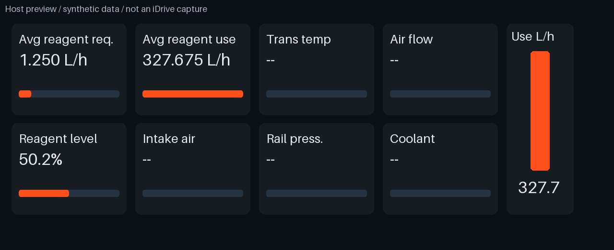

# Standard reagent gauges

BoostDeck adds optional custom gauges for reagent tank level, average reagent
consumption and average demanded reagent consumption. They use advertised
standard PID 85, not a guessed BMW identifier. They are host-tested only; no
N57/B47/B57 ECU, firmware or physical vehicle support is claimed.



The labeled host preview uses production XML, generated images and actual model
updates from the callback test, with host fonts. Its extreme consumption value
checks numeric width and visual clamping; it is not an iDrive capture or a
physical measurement.

Choose **Custom layout**, then select a reagent gauge in the existing picker.
Detected defaults and older selections keep their request sets. Selecting a
reagent gauge is the opt-in to the additional capability page and measurement;
physical trials still require separate owner approval of the new read policy.

## Meaning and evidence

PID 85 requires exactly ten data bytes after `41 85`. Byte A bits 2, 0 and 1
independently support level, average consumption and average demand. High bits
4–7 are reserved and rejected. Byte F gives level × 100 / 255 percent; B-C and
D-E are unsigned big-endian / 200 L/h. Warning-runtime bytes G-J are accepted
as part of the exact layout but are not gauges. Runtime support alone cannot
make any of these three gauges available.

The three layouts agree with
[DashLogic's reference](https://www.dashlogic.com/docs/technical/obdii_pids), the
[pinned OBDb catalog](https://github.com/OBDb/SAEJ1979/blob/1abdef6ae0c1b9134c8f2a10911a9daa1354649d/signalsets/v3/default.json)
and source inspection of the official
[J1699-3 17.00.00 release](https://sourceforge.net/projects/j1699-3/files/j1699/j1699-17.00.00/j1699-ver-17.00.00.zip/download)
(SHA-256 `fa7f6349a5fd57f20295c7b3a01a144f160d1715ffc1bf211a6da20838a4fd39`).
The latter confirms offsets, flags and conversions; this decoder retains
fractional level rather than the reference logger's integer output. No reference
implementation, proprietary database or standard is copied into this branch.

The complete wire ranges remain data: 0–100 percent and 0–327.675 L/h,
including valid zero and all-ones raw values. There is no invented sentinel.
The level describes the ECU's sensing strategy, not confirmed usable fluid
volume in this BMW's tank system. Rates are averages, not instantaneous dosing.
Demand is reported independently; it is not substituted for consumption.

These quantities do not establish SCR health, remaining range, current warning
or inducement state, or DPF regeneration. PID 88 is not polled by this native
feature. There are no reagent/regen controls, resets, new alerts or thresholds.
The separate discovery profiles collect evidence for review, not authorization
to display a BMW-specific source as confirmed.

## Request policy and display

An explicit selected reagent signal follows the complete 00/20/40/60
continuation chain before reading bitmap 80, then reads PID 85 only if
advertised. A separate cache leaves the existing four-page helper and its
default policy unchanged. A new bitmap consumes its call before measurement.
These caches belong to one ECU/endpoint for the worker lifetime.

One request serves the selected reagent fields. Reads are at least two seconds
apart from their actual start. Malformed/refused reads clear this group's
validity and back off five seconds; support flags are checked on every reply.
Each field expires after 3.5 seconds, including receive and queue time. An absent
field shows `--`, never a fabricated zero or another fuel/reagent quantity.
The existing diagnostic lease and HSFZ/MOST ownership/cleanup paths are reused.
Host transport success does not prove cable-free operation on the owner's car.

Units remain percent and L/h under all unit selections. Wide rate labels keep
three decimals, including 0.005 L/h. The narrow ninth tile puts L/h in its
distinct Use/Req caption and rounds its numeric value to one decimal. The
consumption bars use a 10 L/h display scale chosen by this app; values above
that still appear numerically. This scale is not an OEM normal range or fault
threshold.

## Wire, saved layouts and rollback

Existing IDs 0–54 retain their meanings. New IDs 55/56/57 are level, average
consumption and average demand. New valid reagent data uses NBG11 with 58
fields and a 1664-byte buffer bound. NBG10 retains 55 fields and its 1536-byte
bound; older versions retain their prior counts/bounds. A synthetic NBG10
fixture was generated from published `0c2938a` before changing the codec.
Old-only frames still encode byte-for-byte as before. New readers leave
the appended fields unavailable when consuming old packets.

B1–B5 assignments retain their original ID bounds. B6 uses the same file size
and allows IDs below 58. Saves use B6 only if either saved profile contains a
new ID; old-only layouts continue to save their older revision. Default-mode
and unit preferences retain their formats. No installer firmware approval or
new compatibility profile is added.

Deploy matching worker, plugin and regenerated XML/images together, only after
QNX/ABI review and separately authorized parked checks. Back up the prior plugin
and external `BoostDeck.signals`, `BoostDeck.signals.defaults` and
`BoostDeck.prefs` files (or
their absence). Older plugins reject B6; rollback must restore the matching
assignment and mode files along with the plugin. No installation or rollback
has been performed on the owner's vehicle.

## Host checks and remaining validation

```sh
make -C source/native test-reagent
make -C source/native test
python3 source/tools/test_boost_defaults_resources.py
```

Tests cover independent field flags, full raw domains, exact layouts, cold
continuation, bounded failures, frozen NBG10 bytes, strict NBG11 bounds and
freshness, B2–B6 migration, production callbacks/UDP and old default read sets.
Simulated HSFZ/MOST cases check delayed replies, current support loss, refusal,
request periods, conservative ages and resource teardown. CI also applies
sanitizers and static analysis. These are host observations.

Exact DDE advertisement and independent comparisons of the three quantities
remain required, alongside a licensed QNX build, firmware/ABI, rendering,
parked factory-function and standalone checks. No physical result is inferred
from the owner's model description or plausible-looking numbers.

An inherited shared-codec issue is also tracked separately: a host reproduction
at published `0c2938a` accepts a canonical decimal packet in the C locale but
rejects those same bytes under a comma-decimal process locale. No observation
of the actual head-unit numeric locale is available. The locale fix needs its
own regression coverage before claiming that environment works.
