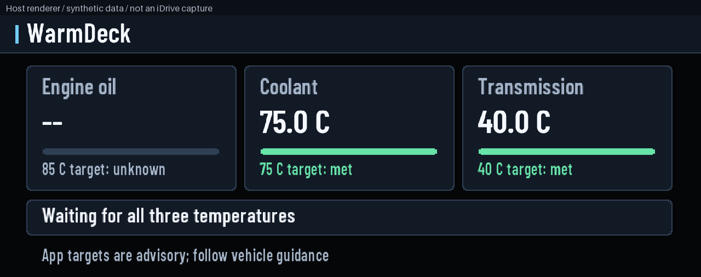

# WarmDeck temperature targets

WarmDeck shows a separate `unknown`, `pending`, or `met` state for engine oil,
coolant, and transmission temperature. Its 85/75/40 °C targets and 81/70/35 °C
release thresholds are application choices, not BMW operating specifications or
permission to use a particular engine speed. The footer directs the driver to
the vehicle's guidance; the former generic 2,500/3,500-RPM guide is removed.

The existing temperature-units preference applies to both measurements and
target labels. Changing units updates the display immediately; the underlying
target comparisons stay in Celsius. The separate experimental DCT-temperature
option retains its source selection and does not share the readiness labels.

An unavailable or expired fluid loses its own target state and trend history.
Other fresh fluids retain their independent states. A complete estimate requires
all three valid readings and a measured rising trend for every fluid still below
its target. Estimates use at least 15 seconds of samples and are suppressed for
flat, falling, or excessively slow trends. They estimate time to the app targets,
not a manufacturer's assessment of engine readiness.

The display accepts only exact-size frames from the existing worker's local UDP
port. Each nonzero sample timestamp must be newer than that fluid's accepted
timestamp, belong to the current opening, and not be in the future. Explicit zero
timestamps mean unavailable and clear the corresponding tile immediately. The
timestamp high-water mark survives that invalidation so queued old positive
samples cannot restore the reading. Invalid numbers and stale samples show `--`.

The existing frame has no worker token or packet sequence. In particular, a zero
invalidation has no timestamp, so a delayed invalidation can conservatively clear
a newer reading until another new sample arrives. This change does not redesign
that protocol or establish worker identity from the port alone.

The worker timestamps a valid reading immediately before its diagnostic request.
Queueing and reply latency therefore count toward the existing 4.5-second
freshness window. This is a conservative age bound, not an ECU-supplied sample
timestamp. A refused, malformed or timed-out read has a zero timestamp; a valid
0 °C reading still has a timestamp. The 48-byte frame is unchanged.

The existing worker requests and decoding are preserved. Standard oil
PID support still depends on the ECU; capability gating is a separate telemetry
change. The existing transmission DID is not newly validated for any N57 variant.
No vehicle compatibility or QNX runtime result follows from the host tests.

## Full-screen WarmDeck

The separate full-screen Library retains raw Celsius samples and computes each
fluid's target state before formatting temperatures. An oil reading of 84.96 °C
can display as 85.0 °C while remaining pending. The renderer receives explicit
unknown/pending/met states and progress; it does not reparse the displayed number
to decide readiness. The RHMI fallback has matching target labels and advisory.
Unit changes refresh measurements and targets together.

The worker's 48-byte temperature frame and diagnostic requests are unchanged.
The Library filters the loopback sender port, rejects malformed, pre-opening,
future and older positive samples, and expires each fluid independently on every
poll. Opening the app or changing the DCT source resets the cache and trend.
The timestamp-free invalidation limitation described above still applies.



This is an actual host rendering of captured production Library updates with
synthetic data and a fake BMW framework, not a QNX or vehicle capture. The
emulator keeps its simulated-feed label. The measured trend model is shared with
the standard app in this same source checkout; build from the whole repository.

The surface protocol is version 2 (`ID6T`), still 496 bytes. Version 1 (`ID6S`)
packets are rejected. Rebuild and deploy the complete matching full-screen
bundle: Library, renderer, dashboard plugins, optional companion plugins and
emulator renderer/overlay where used. Start from a fresh build output and keep
the complete previous bundle for rollback. Firmware, framework-hash and display
checks still apply; this does not supply rebuilt QNX binaries or authorize an
installation.

Host checks run production Library callbacks with controlled local UDP,
intercepted launches/unit saves and a captured surface channel. They cover
rounding, independent hysteresis, missing/stale/zero/invalid readings, sender
filtering, reordering, unit-save failure, trends, source changes and reopening.
The stand-in child never executes diagnostics. The actual C rasterizer is
checked on all five panel sizes for explicit states, text/pixel bounds and
protocol rejection. The original renderer fails the rounded-below-target
control. Generator checks reproduce all menus and check compact/wide fallback
bindings. Emulator checks accept v2 and reject v1 or malformed frames.

No QNX build, physical rendering, factory-function or standalone result follows
from these host checks. Other full-screen diesel features and EntryNav2 ports
remain separate work.

The full-Library analyzer reports the same four existing Boost stream-read
diagnostics as the upstream source, in `boost_preferences.h` and
`boost_layout.h`. This port adds no diagnostics under the same full-screen SDK
include flags. Those unrelated readers are unchanged.

From `source/`, run:

```sh
make -C native test-warm-readiness
python3 -B tools/test_warm_readiness_resources.py
python3 -B tools/test_full_warm_resources.py
```

The production plugin runs against fake BMW framework methods and a controlled
clock, receiving real local UDP fixtures; its worker-launch hook never starts a
worker. Tests cover independent hysteresis, missing and stale fluids, measured
estimates, malformed packets, source filtering, delayed samples, invalid numbers,
and reopening. Resource checks regenerate the XML and all 22 original images,
verify unchanged pixels and component geometry, and check the new text bindings.
CI also runs the full native suite with GCC and Clang, static analysis, and
AddressSanitizer/UndefinedBehaviorSanitizer for the progress and plugin tests.
Three real-worker HSFZ cases add delayed replies, valid zero with refused/malformed fluids,
and invalidation after a timeout. Their gateway is restricted to loopback and
the existing temperature/capability reads. They verify sample age from recorded
request arrival times and resource release after exit. The original worker
fails both delayed-reply timestamp checks; its timeout control already passes.

The updated manifest and generated image archive must be deployed together after
the usual compatibility checks and owner authorization. This source contribution
does not replace the packaged QNX binaries or authorize installation.
